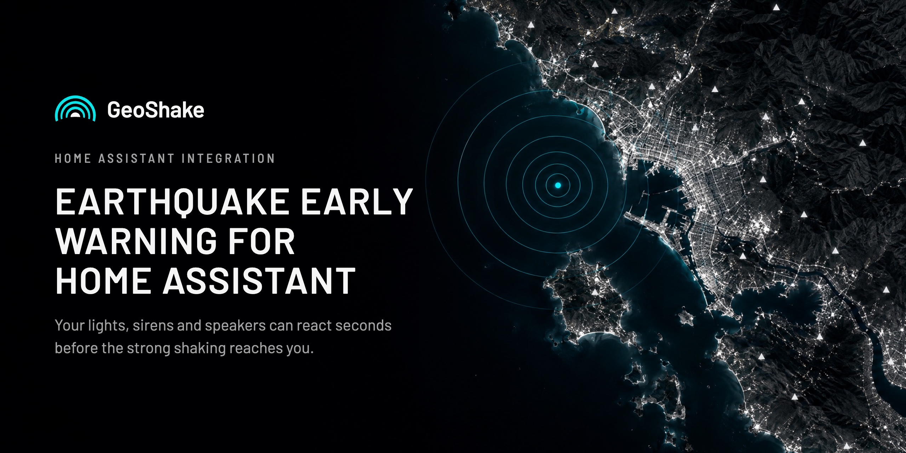
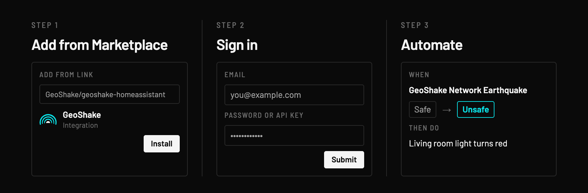
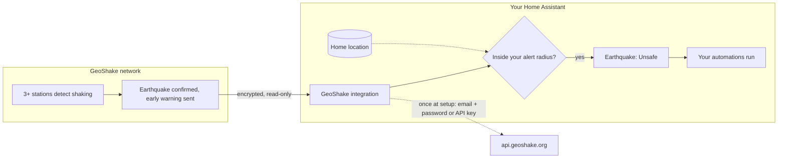

<p align="center">
  
</p>

# GeoShake for Home Assistant

**Earthquake early warning for Home Assistant.** When at least three GeoShake stations close to each other confirm an earthquake, the GeoShake network sends an early warning and your Home Assistant gets it too: the **Earthquake** sensor switches to **Unsafe** and your automations run (lights, sirens, announcements). Depending on your distance from the epicenter, this gives you about **5 to 30 seconds** before the strong shaking reaches you.

[](https://hacs.xyz)
[](https://github.com/GeoShake/geoshake-homeassistant/releases)
[](https://www.home-assistant.io)

[](https://my.home-assistant.io/redirect/hacs_repository/?owner=GeoShake&repository=geoshake-homeassistant&category=integration)
[](https://my.home-assistant.io/redirect/config_flow_start/?domain=geoshake)

Also on [Google Home and Amazon Alexa](#google-home-and-amazon-alexa).



> [!IMPORTANT]
> Early warning is not guaranteed. Close to the epicenter the warning can arrive after the shaking has started, and automations can be delayed or fail to run. Treat this as a helpful extra layer, not a life-safety system: keep alerts on in the GeoShake app and follow your national authority's official warnings.

## Will it work where I live?

- **It needs GeoShake stations around you.** The Earthquake sensor switches only when at least three GeoShake stations close to each other detect the same earthquake. Open the [live map](https://map.geoshake.org) to see the stations near you.
- **No coverage yet?** A [GeoShake T1](https://geoshake.org/geoshake-t1) in your home puts your area on the network. With three stations near each other, earthquakes around you get confirmed.
- **You choose the distance.** By default, confirmed earthquakes within 300 km (186 miles) of your Home Assistant home location switch the sensor.
- **You'll need a GeoShake account.** Create one in the GeoShake app.

<a href="https://apps.apple.com/app/id6755887999"></a>&nbsp;<a href="https://play.google.com/store/apps/details?id=com.geoshake"></a>

## Install

**You'll need:** Home Assistant 2024.11 or newer (OS, Container or Supervised), [HACS](https://hacs.xyz) and your GeoShake account. It takes about five minutes.

1. **Add the repository to HACS.** Use the HACS button above. Or open HACS, go to **⋮ → Custom repositories**, paste `https://github.com/GeoShake/geoshake-homeassistant` and choose the type **Integration**.
2. **Download.** Search for **GeoShake** in HACS, click **Download**, then restart Home Assistant (**Settings → System → Restart**).
3. **Add the integration.** Go to **Settings → Devices & services → Add integration**, search for **GeoShake** and choose **Sign in with GeoShake account**.
4. **Sign in** with your GeoShake email and password.

> [!TIP]
> **Signed up with Google or Apple?** Your account has no password. Sign in at [my.geoshake.org](https://my.geoshake.org), open **Settings**, copy your **API key** and paste it into the **Password or API key** field.

Your password is used once to create a personal, read-only connection. Home Assistant never stores it. A **GeoShake Network** device appears with three entities. The integration makes its own connection and leaves Home Assistant's MQTT integration free for your other devices.

**Quick check:** open **Developer tools → States** and filter by `geoshake`. Earthquake shows `off` and Connection shows `on`.

## Your first automation

1. Go to **Settings → Automations & scenes → Create automation → Create new automation**.
2. **When:** **Add trigger → Entity → State**. Entity: **GeoShake Network Earthquake**. From: **Safe**. To: **Unsafe**.
3. **Then do:** add an action, for example turn a light red.
4. **Save** it as *GeoShake earthquake alert*.

> [!NOTE]
> **Why set From and To?** If you leave them empty, the automation also runs when the sensor goes `unavailable` during an internet outage, and again when the alarm clears.

<details>
<summary>The same automation in YAML</summary>

```yaml
alias: GeoShake earthquake alert
triggers:
  - trigger: state
    entity_id: binary_sensor.geoshake_network_earthquake
    from: "off"
    to: "on"
actions:
  - action: light.turn_on
    target:
      entity_id: light.living_room
    data:
      color_name: red
      brightness_pct: 100
mode: single
```

</details>

**More ideas**

| Goal | Action |
|---|---|
| Flash lights red | `light.turn_on` with color red, brightness 100% |
| Sound a siren on a smart plug | `switch.turn_on` on the plug |
| Spoken announcement | `tts.speak`: "Earthquake confirmed by the GeoShake network. Take cover." |
| Phone notification | `notify.mobile_app_<your_phone>` |

## What you get

| Entity | What it shows |
|---|---|
| **Earthquake**<br>`binary_sensor.geoshake_network_earthquake` | **Unsafe** when the network confirms an earthquake inside your alert radius. Back to **Safe** 2 minutes after the last event. |
| **Last event**<br>`sensor.geoshake_network_last_event` | Time of the latest confirmed earthquake anywhere on the network. Attributes: `intensity_class`, `stations`, `max_pga`, `latitude`, `longitude`, `distance_km`. |
| **Connection** (diagnostic)<br>`binary_sensor.geoshake_network_connection` | Whether Home Assistant is connected to GeoShake. |

## Google Home and Amazon Alexa

GeoShake also works without Home Assistant:

- **Google Home:** a certified Works with Google Home integration. Link your GeoShake account in the Google Home app and an Earthquake sensor appears for your routines. [Setup guide](https://geoshake.org/integrations#google-home)
- **Amazon Alexa:** enable the [GeoShake skill](https://www.amazon.com/dp/B0HKY24SPP) (United States and Canada, in English) and the GeoShake Earthquake Sensor starts your Alexa routines. [Setup guide](https://geoshake.org/integrations#alexa)

Both react to confirmed earthquakes within 300 km of the GeoShake T1 registered to your account.

## Privacy: what leaves your home



- **Once, at setup.** Your email and password (or API key) go to `api.geoshake.org` over HTTPS. GeoShake creates a personal, read-only connection for you. Home Assistant stores only that connection, never your password.
- **After that, data only flows in.** Home Assistant receives the network's confirmed earthquakes over an encrypted (TLS) connection to `mqtt.geoshake.org`. The connection is read-only and cannot publish anything.
- **Your home location stays in Home Assistant.** Every confirmed event arrives, and the integration calculates the distance to your home locally. Only events inside your alert radius switch the sensor.
- **What our server sees.** Like any online service, it sees when your Home Assistant connects and the IP address it connects from.

## Options

**Settings → Devices & services → GeoShake → Configure**

| Option | Default | What it does |
|---|---|---|
| Alarm auto-clear delay | 120 s | How long Earthquake stays Unsafe after the last event. |
| Alert radius from home | 300 km | Only confirmed earthquakes within this distance of your Home Assistant home location switch the sensor. Set 0 to react to every confirmed network event. |

## Troubleshooting

<details>
<summary>The Earthquake sensor shows "unavailable"</summary>

Home Assistant lost its connection to GeoShake, usually because the internet dropped. It reconnects on its own and the sensor returns to Safe. Set **From: Safe** and **To: Unsafe** in your trigger so an outage never sets off your alarm.

</details>

<details>
<summary>GeoShake doesn't show up when I search HACS</summary>

GeoShake is installed as a custom repository. Use the HACS button above, or add the repository under **⋮ → Custom repositories** first. Then the search finds it.

</details>

<details>
<summary>Sign-in says "Invalid email or password"</summary>

If you signed up with Google or Apple, your account has no password. Use your API key from **my.geoshake.org → Settings** instead.

</details>

<details>
<summary>I set it up again and my other installation disconnected</summary>

Each sign-in creates fresh connection details for your account, and the previous ones stop working. Keep one GeoShake installation per account.

</details>

<details>
<summary>How do I test my automation without an earthquake?</summary>

Open **Developer tools → States**, select `binary_sensor.geoshake_network_earthquake`, set the state to `on` and click **Set state**. Your automation runs as if the network had confirmed an earthquake.

</details>

<details>
<summary>My alarm has never gone off</summary>

That is expected until the network confirms an earthquake inside your alert radius. Check the [live map](https://map.geoshake.org) for stations near you and make sure Connection shows `on`.

</details>

<details>
<summary>Moving from the old manual MQTT setup</summary>

1. Remove the GeoShake `mqtt: binary_sensor:` block from `configuration.yaml`.
2. If the GeoShake broker was set up in Home Assistant's MQTT integration, delete that entry or point it back to your own broker. This integration connects on its own.
3. Update your automations to `binary_sensor.geoshake_network_earthquake`.

</details>

## Help

- **Discord:** [discord.gg/t8CYryruPb](https://discord.gg/t8CYryruPb) (#setup-help)
- **Email:** info@geoshake.org
- **Bug or idea:** [open an issue](https://github.com/GeoShake/geoshake-homeassistant/issues)
- **Full guide:** [geoshake.org/integrations](https://geoshake.org/integrations#home-assistant)

Working on the integration itself? See [CONTRIBUTING.md](CONTRIBUTING.md).
